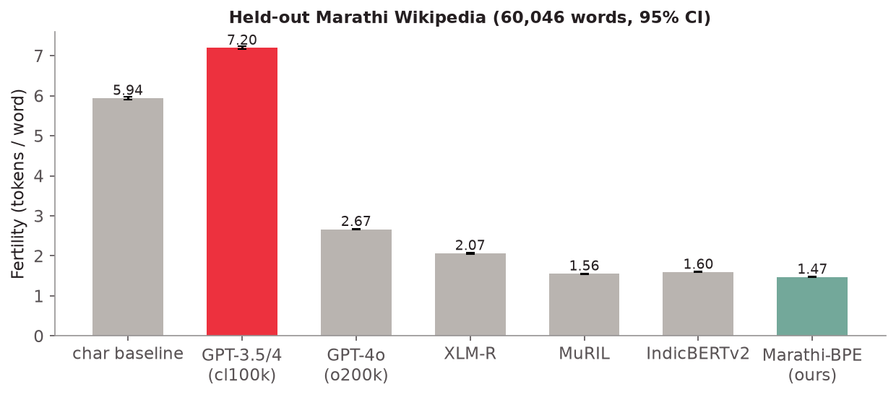
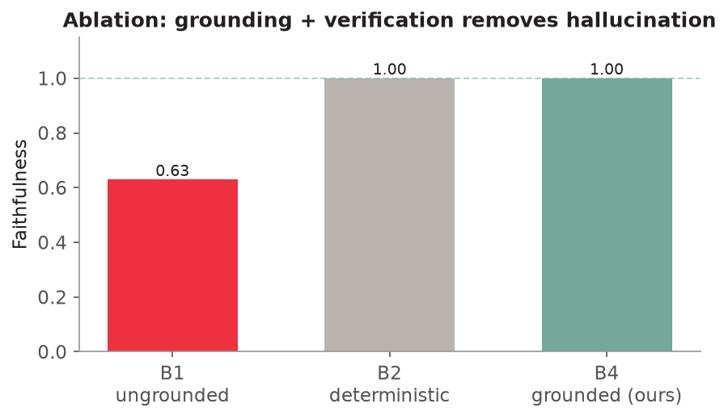
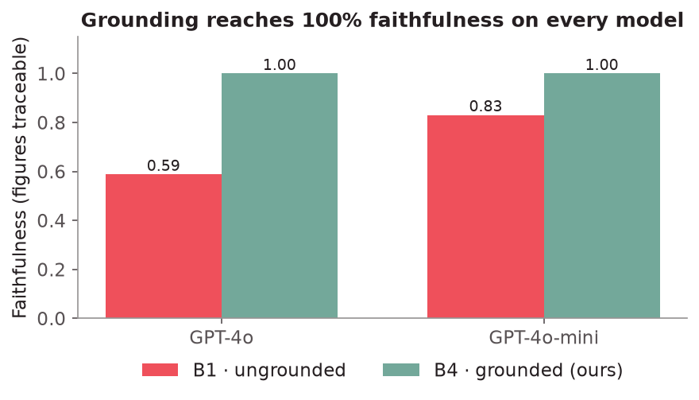
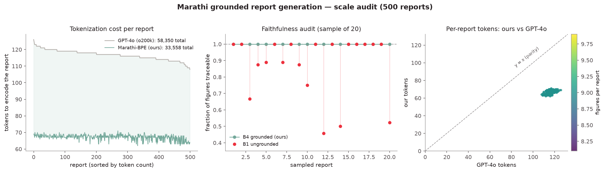
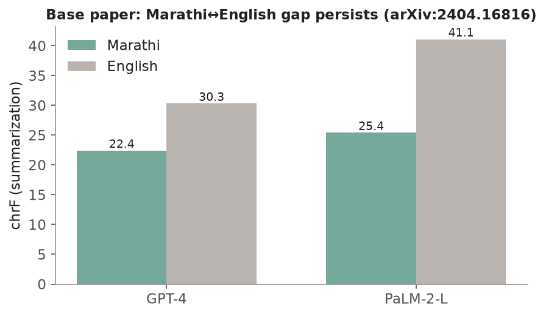
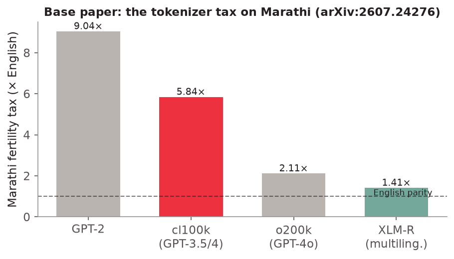

# Marathi Grounded Report Generator

**Generate official-style reports in Marathi from a subject + a few details, where
every number is traceable to its source — natively, without translating through
English — and export a compile-ready LaTeX document.**

An NLP project on *retrieval-grounded, structure-constrained generation* for a
low-resource, morphologically rich language.

> **Core method — SymGen.** This project applies *symbolically grounded generation*
> (**SymGen**; Torroba Hennigen, Shen, Nrusimha, Gapp, Sontag & Kim — MIT & Good Data
> Initiative, **COLM 2024**, [arXiv:2311.09188](https://arxiv.org/abs/2311.09188),
> [symgen.github.io](https://symgen.github.io)) to Marathi administrative reports.
> SymGen has the LLM emit `{{ field }}` references into the source data instead of raw
> values, which a parser then renders — **exactly the mechanism our pipeline uses.** We
> extend it to a low-resource language, add a hard verifier that *rejects* ungrounded
> numbers, train a Marathi tokenizer, and test at scale. See §8.

---

## 1. Problem Statement

Marathi is the official language of Maharashtra, yet almost every structured
reporting workflow in the state — Gram Panchayat activity reports, agricultural
advisories, district health filings — is either handwritten or **drafted in English
and translated afterwards**. The result is delay, inconsistent terminology, and a
loss of meaning exactly where it matters most: at the Marathi-first reader.

**The task, stated precisely:** given a subject and a set of structured details
(label → value facts), produce a template-faithful administrative report in Marathi
in which **every numeric claim is traceable back to a source detail**, generated
natively in Marathi.

---

## 2. Why this is hard (what currently goes wrong)

Current LLMs handle this poorly for three concrete reasons:

1. **Hallucination is unacceptable here.** A single fabricated figure in a subsidy
   or yield report has real consequences. But free-form LLMs *invent* plausible
   numbers. In our own tests, GPT-4o writing Marathi reports freely left **~37% of
   its numbers unsupported** (not present in the source data).

2. **Devanagari fragments under standard tokenizers.** Tokenizers are trained
   mostly on English, so they shatter Marathi into many tokens — raising cost and
   lowering quality. This is a published, measured effect (the "tokenizer tax").

3. **No standardized register.** Models drift between formal Sanskritised Marathi,
   colloquial speech, and code-mixed Marathi-English, because there is no agreed
   lexicon for administrative/agri-technical Marathi.

And the common workaround — **write in English, then machine-translate to Marathi**
— adds its own delay and distortion, and still isn't faithful to the source numbers.

---

## 3. Our Solution

A pipeline that **grounds** generation in the input and **verifies** it before
output:

- **You give:** a subject, a report type, and a few `label → value` details (plus
  optional context notes).
- **The system writes** a full multi-section report in Marathi, but the generator
  is *constrained*: it must write every value as a `{{placeholder}}` token, never a
  raw number.
- **We substitute** each placeholder with its real value and tag it with a source
  id → every figure is traceable **by construction**.
- **A verifier** scans the output and flags any number that isn't backed by a
  source detail.
- **Output:** the Marathi report on screen (figures highlighted + linked to source)
  and a compile-ready **XeLaTeX** document.

It runs as a CLI, a FastAPI backend, and a React web app.

---

## 4. Why this is better

| vs. … | Why ours wins |
|---|---|
| **Raw LLM (ungrounded)** | It hallucinates figures; we drive unsupported numbers to **zero** via grounding + verification. |
| **English → translate pivot** | We generate **natively in Marathi** — no translation step to add delay or distort numbers. |
| **A fixed template / mail-merge** | We produce fluent, multi-section prose that adapts to the subject, yet stays grounded. |
| **English-centric tokenizer** | Our trained Marathi tokenizer encodes the same text in far fewer tokens (see §6). |

The key idea: **faithfulness is guaranteed by construction (symbolic placeholders),
not by hoping the model behaves.**

---

## 5. How we built it — the pipeline

Five components (`pipeline/`):

1. **Parse** — each detail becomes a typed record with a stable source id (`F1`, `F2`…).
2. **Ground** — each report section is bound to the exact details it may use, *before* any text is generated.
3. **Generate** — the LLM (GPT-4o) writes the Marathi report using `{{placeholder}}` tokens for every value.
4. **Resolve** — each placeholder is substituted with its value + source id → traceable tokens.
5. **Verify** — every number must map to a source detail; stray numbers are flagged as unsupported.

Steps 3–4 are **SymGen's "Direct" symbolic generation** (arXiv:2311.09188): the model
emits `{{ field }}` references and a parser renders them. Step 5 is our addition — a
hard verifier that *rejects* any number not bound to a source field, so faithfulness is
*enforced*, not merely made easier to check by hand.

---

## 6. The tokenizer — a measurement, not a pipeline component

**Why.** Standard LLM tokenizers over-fragment Devanagari, which raises cost. We
wanted to *measure* this with a tokenizer trained on real Marathi, against fair
Indic-aware baselines.

**Scope — read this first.** This tokenizer is **not used in generation**: GPT-4o
writes the reports with its own tokenizer. Ours only *measures* what a Marathi-native
tokenizer would cost, so it does **not** change the pipeline's generation cost.

**How we built it** (trained from scratch, not fine-tuned):
- **BPE** via HuggingFace `tokenizers`, NFC normalisation, whitespace pre-tokenization,
  **32,000** vocabulary entries (all filled), `min_frequency = 2`.
- **Training data: real Marathi Wikipedia** (`wikimedia/wikipedia` 20231101.mr),
  **10.2M words**. Fetched with `python -m scripts.fetch_marathi_wiki`.
- **Held-out set: 60,046 words from 1,600 paragraphs of articles never seen in
  training** (split by article hash, so no leakage). General Marathi, not
  administrative. Metric: **fertility** = tokens/word, with 95% bootstrap CIs.

Commands: `python -m scripts.fetch_marathi_wiki && python -m pipeline.train_tokenizer`

**Results — fertility (tokens/word), held-out Marathi Wikipedia:**

| Tokenizer | Vocab | Fertility (95% CI) |
|---|---|---|
| char baseline | – | 5.94 |
| GPT-3.5 / GPT-4 (`cl100k_base`) | 100k | 7.20 [7.16, 7.23] |
| GPT-4o (`o200k_base`) | 200k | 2.67 [2.65, 2.68] |
| XLM-R | 250k | 2.07 [2.05, 2.08] |
| MuRIL | 197k | 1.56 [1.55, 1.57] |
| IndicBERTv2 | 250k | 1.60 [1.59, 1.61] |
| **Marathi-BPE (ours)** | 32k | **1.47 [1.46, 1.48]** |

What this supports: general-purpose GPT tokenizers pay a large Marathi tax (cl100k is
worse than character-level; o200k is ~1.8× ours). What it does **not** support: a
meaningful win over Indic-aware tokenizers — ours is only ~6% below MuRIL/IndicBERTv2,
and ours is trained and tested on the *same genre* (Wikipedia), while theirs are
trained on broader text. Treat the ranking among the last three rows as roughly a tie.
On the 49-word administrative held-out set (too small for a CI) IndicBERTv2 (1.33)
and ours (1.37) are indistinguishable.



*History:* an earlier version of this section trained on ~1.6k words of template-generated
administrative text (vocab 2,000, only 1,532 entries filled) and reported 2.18 vs GPT-4o's
2.80 on 49 words. That was noise plus in-template memorisation and has been replaced.
The old model is kept as `tokenizers/marathi_bpe_admin_toy.json` for reference only.

---

## 7. What we tested, and what we found

**Experiment A — does grounding stop hallucination?** (B1→B4 ablation)
Same model, different scaffolding, over a 10-report benchmark:

| System | Faithfulness | chrF++ | Code-mix | Avg tokens |
|---|---|---|---|---|
| B2 · deterministic template | 1.000 | 0.993 | 0.000 | 38 |
| **B1 · ungrounded LLM (control)** | **0.629** | 0.406 | 0.000 | 120 |
| **B4 · grounded + verified (ours)** | **1.000** | 0.454 | 0.000 | 33 |

→ Ungrounded leaves **37% of numbers unsupported**; grounded reaches **zero invented
figures**, and is more concise.



**Experiment B — does it depend on the model?** (B1 vs B4 across models)

| Generator | B1 ungrounded | B4 grounded (ours) |
|---|---|---|
| GPT-4o | 0.588 | **1.000** |
| GPT-4o-mini | 0.831 | **1.000** |

→ Ungrounded hallucination varies by model; **grounding reaches 1.000 on every
model** — the method is model-independent.



**Experiment C — tokenizer fertility** → see §6.

**Experiment D — does it hold at scale?** (500-report audit)
We generated a **500-report synthetic benchmark** (`data/benchmark_large/`) and audited it:

- **Faithfulness over all 500 reports: 1.000** (zero unsupported figures) — the
  verifier holds at scale, not just on cherry-picked examples.
- **Token cost (template text, indicative only):** the Wikipedia-trained tokenizer
  encodes the 500 template-generated reports in 33,558 tokens vs GPT-4o's 58,350
  (1.74×). Because the reports come from one template this is an in-template figure,
  not evidence of general efficiency, and generation still uses GPT-4o's tokenizer.
- **Ungrounded vs grounded (sample of 20 LLM runs):** B1 **0.871** → B4 **1.000**.



*Left:* token counts for the template reports, ours vs GPT-4o's.
*Middle:* a faithfulness audit — grounded (B4) sits flat at 1.0 while ungrounded (B1)
drops wherever the model invented a figure. *Right:* per-report token counts, ours vs
GPT-4o, every point below the parity line.

**Metrics beyond BLEU.** BLEU correlates poorly for inflectional low-resource
languages, so we report **faithfulness** (our headline), **chrF++**, **code-mix
rate**, and token cost.

---

## 8. How this sits in the literature — what the base papers built & found

### ★ SymGen — our central paper (COLM 2024 — arXiv:2311.09188)
*Torroba Hennigen, Shen, Nrusimha, Gapp, Sontag & Kim (MIT & Good Data Initiative).*

**Method.** The LLM writes its answer in Jinja-style `{{ field }}` references into a JSON
input; a parser swaps each reference for its value, so every span links back to a source
field. Two modes — **Direct** (symbolic text in one pass) and **Indirect** (plain text
first, then rewritten with references: ~2× the tokens, GPT-4 only, since GPT-3.5 was
unreliable with it). A failed reference renders as "undefined"; an unparseable output is
replaced by a "text not available" message.

**Setup.** Datasets: SynthBio (364), counterfactual obituaries, Rotowire basketball
summaries (100 sampled), financial QA (32), and GSM8K / GSM-hard. Models: GPT-3.5 and
GPT-4 (0613). Baseline: the same model answering without references (chain-of-thought and
PAL for the maths tasks).

**Results (confirmed from the paper's tables).**
- **Reference accuracy** (Rotowire): **99.77%** (GPT-3.5) / **99.52%** (GPT-4), vs a regex
  post-hoc baseline's **35.40% / 46.10%** (9,068 human annotations, 97.8% agreement).
- **Human study** (60 annotators): error-finding accuracy ~unchanged (80.83% vs 80.00%),
  but verification **~20% faster** (1.98 vs 2.50 min) and perceived easier.
- **Text quality: mixed** — BLEU improved on SynthBio with GPT-4 (36.83 vs 32.43) but
  trailed the baseline on Rotowire; GPT-3.5 often did worse with symbols.
- **Maths:** beat chain-of-thought on GSM-hard, lost to PAL.
- **Stated limits:** a correct reference can still sit in a wrong sentence; results use
  closed models; samples are small.

**How our project compares.** SymGen never measured the quantity we do — the **rate of
unsupported numbers in free generation** (our 0.629 → 1.000). It has no Indian-language
work, no tokenizer study, and **no automatic verifier**: its measure of success is human
checking *speed*, whereas ours is *enforced* faithfulness. Two of its findings reinforce
our framing: SymGen's **text quality sometimes dropped** (so a surface metric like chrF
alone isn't enough — faithfulness is the right headline), and it found **GPT-3.5 less
reliable with symbols** (which our two-model B1→B4 test echoes). Concretely we extend it
by: (1) a low-resource target (Marathi/Devanagari); (2) a hard verifier that *rejects*
ungrounded numbers; (3) a trained Marathi tokenizer; (4) a 500-report scale audit.

### IndicGenBench (Google Research India, 2024 — arXiv:2404.16816)
**What they built:** the largest benchmark for evaluating LLM *generation* on Indic
languages — **29 languages, 13 scripts, 4 families**, across five human-curated,
multi-way-parallel tasks: cross-lingual summarization (CrossSum-IN), machine
translation (FLORES-IN), multilingual QA (XQuAD-IN), and cross-lingual QA
(XORQA-IN). Marathi is one of the covered languages.

**What they found:**
- They benchmarked GPT-3.5, GPT-4, PaLM-2, mT5, Gemma, BLOOM/BLOOMZ, LLaMA.
  **PaLM-2-L was best overall**; open models (LLaMA) lagged proprietary ones badly.
- A **large, consistent English↔Indic gap** (often 20+ points) remains even for
  frontier models. For Marathi summarization: **GPT-4 chrF 22.4 vs 30.3 English**;
  PaLM-2-L 25.4 vs 41.1.
- They deliberately report **chrF, not BLEU/ROUGE**, stating token metrics "are not
  reliable for low-resource languages" — which independently validates our metric choice.



### The Tokenizer Tax (2026 — arXiv:2607.24276)
**What they built:** a content-controlled measurement (on FLORES-200) of the
"tokenizer tax" — fertility relative to English — across **10 Indian languages and 6
tokenizers**, plus a mechanistic explanation and a remediability analysis.

**What they found:**
- The Marathi word-fertility tax vs English is **9.04× (GPT-2), 5.84× (cl100k =
  GPT-3.5/4), 2.11× (o200k = GPT-4o), 1.41× (XLM-R)**; mean Indic tax **8.0×**, up to
  13× for Malayalam.
- **Cause:** failed BPE merges leave Devanagari stranded as single bytes (correlates
  with the tax at r = 0.89).
- **It's a design choice, not the script's fault:** a language-aware tokenizer nearly
  erases the tax, and o200k already cut the mean Indic tax **73%** vs cl100k.



### IndicNLG Benchmark (Kumar et al., EMNLP 2022 — arXiv:2203.05437)
**What they built:** the first NLG benchmark for Indic languages — ~8M examples across
**5 generation tasks in 11 Indic languages**: **biography generation from Wikipedia
infoboxes (a data-to-text task), news-headline generation, sentence summarization,
paraphrase generation, and question generation**. Datasets + models released publicly.

**Why it matters for us:** biography-from-infobox is exactly our *table → text* task
family, in Indic languages — so our Marathi report generation sits squarely in the
space this benchmark defines, and its task design is a template for a future
*real-data* Marathi benchmark.

### IndicTrans2 (Gala et al., TMLR 2023 — arXiv:2305.16307)
**What they built:** AI4Bharat's **first open-source NMT model for all 22 scheduled
Indian languages**, plus the Bharat Parallel Corpus Collection (230M bitext pairs) and
the IN22 benchmark; MIT-licensed.

**Why it matters for us:** IndicTrans2 is the strongest open MT system a
**translate-pivot baseline (B0)** would use — "write in English, then translate to
Marathi." Our thesis is that *native grounded generation* avoids that pivot's delay and
numeric distortion; IndicTrans2 is the concrete system we would compare against.

**Why this matters for us:** these papers establish the exact gaps we target — frontier
models underperform on Marathi, BLEU is the wrong metric, standard tokenizers overcharge
Devanagari, Indic data-to-text is an active benchmark area, and translation is the pivot
we aim to avoid.

### Closely related work (faithfulness & low-resource data-to-text)
The nearest neighbours to our setting, for a related-work comparison:
- **Faithful Low-Resource Data-to-Text Generation through Cycle Training** (Wang et al.,
  ACL 2023 — arXiv:2305.14793) — the closest work on *faithfulness* in low-resource
  data-to-text; improves faithfulness via cycle training rather than symbolic references.
- **Guided Beam Search to Improve Generalization in Low-Resource Data-to-Text Generation**
  (INLG 2023) — another low-resource data-to-text approach, via constrained decoding.
- **Survey of Hallucination in Natural Language Generation** (Ji et al., ACM Computing
  Surveys 2023 — arXiv:2202.03629) — background on hallucination types and mitigations.

### Other method foundations
Controlled table-to-text (ToTTo, 2004.14373); plan-based retrieval grounding
(2408.10490); morphology-grounded Indic tokenization (MorphTok, 2504.10335).
(The core symbolic-reference method is SymGen, above.)

---

## 9. Honest limitations (what we do *not* claim)

Stated up front, because they matter:

- **The benchmark is synthetic.** The reports, gold answers, tokenizer corpus, and
  held-out set were generated by us, not drawn from real Gram Panchayat records.
  The *measurements* are real; the *data under them* is not yet real.
- **The tokenizer is a measurement, not part of generation.** GPT-4o generates with
  its own tokenizer, so our tokenizer does not reduce generation cost. It is trained
  on Wikipedia and evaluated on held-out Wikipedia (same genre), and only marginally
  beats MuRIL / IndicBERTv2 (§6). Its advantage over GPT tokenizers is real; over
  Indic-aware ones it is within a few percent.
- **chrF here is measured against template-style gold**, so it understates the LLM's
  fluency. Faithfulness is the defensible headline metric; a fair fluency number
  needs human raters.
- **Ungrounded hallucination is probabilistic** — 0.629 is an average over reports,
  not a guarantee on any single run.

**Next steps:** real Gram Panchayat data, native-Marathi human evaluation, a
translate-pivot (B0) baseline, and evaluating the tokenizer on non-Wikipedia Marathi (news, IndicCorp, administrative text).

---

## 10. Run it

```bash
# Backend + pipeline
python3.11 -m venv .venv         # or: uv venv -p 3.11 .venv
uv pip install --python .venv/bin/python -r requirements.txt
cp .env.example .env             # add your OPENAI_API_KEY

# CLI — one report (offline deterministic engine works without a key)
.venv/bin/python -m pipeline.cli data/sample/gram_panchayat_sample.csv

# Real Marathi corpus (article-level split) + tokenizer training + fertility comparison
.venv/bin/python -m scripts.fetch_marathi_wiki
.venv/bin/python -m pipeline.train_tokenizer

# Evaluation — the B1 / B2 / B4 results table
.venv/bin/python -m eval.run_eval

# Regenerate the figures in this README
.venv/bin/python figures/make_figures.py

# Backend server
.venv/bin/uvicorn server.app:app --port 8000
```
```bash
# Frontend (new terminal)
cd frontend && npm install && npm run dev      # http://localhost:5173
```
The web app: **New report** (enter subject + details) → **Generate** → **Results**
(live grounded-vs-ungrounded comparison, timing, tokenizer comparison, benchmark,
and literature). **About the method** explains the full approach. The generated
`report.tex` compiles with **XeLaTeX** (or Overleaf → XeLaTeX).

---

## 11. Repo layout
```
pipeline/   the NLP system: parse, ground, generate, resolve, verify, report
            + train_tokenizer.py (trains + benchmarks the Marathi BPE tokenizer on real Wikipedia)
server/     FastAPI backend (/api/report, /api/report/compare, /api/generate)
eval/       metrics + B1/B2/B4 harness + RESULTS.md + multimodel_results.json
frontend/   React (Vite) app — the two-screen demo
latex/      XeLaTeX template (Noto Serif Devanagari) for the .tex output
lexicon/    domain terminology bank (register control)
data/       benchmark reports, corpus, samples  (synthetic — see §9)
figures/    research-style charts (make_figures.py) embedded in this README
plan.md     the detailed, paper-grounded NLP plan
```

---

*Deliverables: an open Marathi report-generation benchmark, a reusable domain
lexicon, a trained Marathi tokenizer, and a deployable pipeline showing that
grounded generation in a low-resource Indic language eliminates numeric
hallucination — without translation as an intermediate step.*
